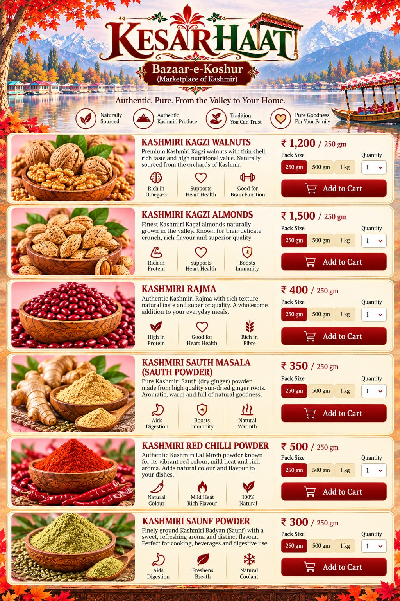

# KESAR | Bazaar-e-Koshur
### *“Marketplace of Kashmir”*

> [!NOTE]
> **Brand Identity:** **KESAR** · *Bazaar-e-Koshur* *(Marketplace of Kashmir)*  
> **Tagline:** *Authentic. Pure. From the Valley to Your Home.*

---

## Foreword: Bringing Kashmir to You

> **More than commodities, we bring you the soul of Kashmir.**  
>  
> Its age-old flavours, treasured traditions, authentic craftsmanship and rich cultural heritage, carefully sourced from the valleys of Kashmir and brought to homes beyond its mountains.  
>  
> *Our endeavour is simple: preserve what is timeless, celebrate what is Kashmiri, and carry its legacy forward.*  
>  
> **Kashmir: its flavours, its heritage, its soul.**

---

## Our Story

Our connection with Kashmir is not a business idea. **It is our inheritance.**

My father, **Durganath Tikoo**, grew up in Shalakadal, Habbakadal, Srinagar, in the family home built by my grandfather in the early 19th century. Like many Kashmiri Pandit families, our family had a long tradition of serving in Government.

My mother, **Late Asha Pandita Tikoo**, grew up in Zolur village, Sopore, the daughter of a farmer. She brought with her something truly special: a natural, almost God-gifted understanding of food, spices, fruits and dry fruits.

Because of my father's postings, our family moved across different parts of India, eventually making Lucknow our home. Yet, wherever we lived, **Kashmir travelled with us.**

While the world around us embraced new cuisines and changing tastes, our home remained anchored in the traditions we had inherited. The food, the aromas, the recipes and the rituals of Kashmir remained unchanged.

And at the heart of it all was my mother's kitchen, where generations-old Kashmiri flavours came alive through her extraordinary culinary skills. Her food and lavish Kashmiri spreads became a cherished part of our family identity.

Today, **Kashmir Commodities** is our way of taking that legacy beyond our home, sharing the authentic flavours, traditions and treasures of Kashmir with the world.

> [!IMPORTANT]
> *Because some legacies are not meant to be forgotten.*  
> **They are meant to be carried forward.**

---

### A Return to My Roots

For nearly 30 years, I lived the corporate life, crisscrossing India and working overseas. Yet, through it all, Kashmir remained close to my heart.

My love for cooking began in college. It runs in our family, and I was always drawn to the kitchen, experimenting with flavours, participating in culinary fests and, most importantly, staying connected to my *Matamaal* (*Nanihaal*) and the traditions I grew up with.

Over time, I realised that many of those authentic Kashmiri aromas, ingredients and traditions were slowly fading from everyday life.

That became the inspiration for **Kashmir Commodities**.

My second innings is therefore more than a business. It is a return to my roots, with a promise to preserve what we inherited and bring the authentic flavours of Kashmir to homes everywhere.

> [!NOTE]
> **Kashmir Commodities**: *Bringing the Valley to your kitchen.*

**Founder:**  
**Sandeep Tikoo**

---

## Product Catalogue & Heritage Collection

> [!TIP]
> Each spice and dry fruit in our collection is carefully selected from traditional orchards and artisanal growers in Kashmir to ensure uncompromised authenticity, purity, and aroma.

| # | Item | Kashmiri Name | Category | Flavour Profile |
|:---:|---|---|---|---|
| **1** | Fennel Seed Powder | *Badyan / Saunf* | Pure Spice | `Sweet` • `Warm` • `Refreshing` • `Aromatic` |
| **2** | Kashmiri Red Chilli | *Lal Mirch* | Pure Spice | `Mild` • `Earthy` • `Aromatic` • `Gently Warm` |
| **3** | Handcrafted Spice Cake | *Ver Masala Tikki* | Spice Blend | `Earthy` • `Warm` • `Aromatic` • `Rich` |
| **4** | Sun-Dried Ginger Powder | *Soth Masala* | Pure Spice | `Warm` • `Earthy` • `Aromatic` • `Gently Pungent` |
| **5** | Thin-Shelled Walnuts | *Kagzi Akhroot* | Dry Fruit | `Rich` • `Buttery` • `Mildly Sweet` • `Nutty` |
| **6** | Thin-Shelled Almonds | *Kagzi Badaam* | Dry Fruit | `Delicate` • `Naturally Sweet` • `Creamy` • `Nutty` |

---

### 1. Kashmiri Badyan | Saunf Powder
*The aromatic heart of Kashmiri cuisine*

Kashmiri Badyan, traditionally made from finely ground fennel seeds (*saunf*), is prized for its naturally sweet, warm and refreshing aroma. It is an essential ingredient in many traditional Kashmiri preparations, lending dishes a distinctive fragrance and delicate sweetness.

#### Key Qualities
- 🌿 **Naturally aromatic:** Fresh, sweet and distinctly Kashmiri.
- 🥘 **Traditional culinary ingredient:** Used in gravies, curries, meat preparations and spice blends.
- 🌱 **Naturally rich in plant compounds:** Fennel contains naturally occurring essential oils and antioxidants.
- ✨ **Finely ground & versatile:** Easy to blend into everyday cooking.
- 🏔️ **A taste of Kashmiri heritage:** An ingredient deeply associated with the flavours of the Valley.

- **Taste Profile:** `Sweet` • `Warm` • `Refreshing` • `Aromatic`

> [!TIP]
> **Catalogue Line:** *“A little Badyan, and the unmistakable aroma of Kashmir comes alive.”*

---

### 2. Kashmiri Lal Mirch Powder
*The vibrant soul of Kashmiri cuisine*

Kashmiri Lal Mirch is cherished for its brilliant natural red colour, gentle warmth and distinctive earthy aroma. It adds richness and depth to traditional Kashmiri dishes without overpowering their delicate flavours.

#### Key Qualities
- 🌶️ **Naturally vibrant:** Lends dishes a beautiful, deep red colour.
- 🔥 **Mild & balanced:** Gentle heat with a subtle sweetness.
- 🍛 **Deeply versatile:** Ideal for curries, gravies, meats and traditional preparations.
- 🌿 **Aromatic & flavourful:** Adds warmth and depth to every dish.
- 🏔️ **Kashmiri culinary heritage:** An essential spice of the Valley’s kitchen.

- **Taste Profile:** `Mild` • `Earthy` • `Aromatic` • `Gently Warm`

> [!TIP]
> **Catalogue Line:** *“A touch of Kashmiri Lal Mirch: colour, warmth and the soul of the Valley.”*

---

### 3. Kashmiri Ver Masala Tikki
*The soul of traditional Kashmiri cooking*

Handcrafted from a traditional blend of aromatic Kashmiri spices, Ver Masala Tikki is a cherished culinary heritage of the Valley. Traditionally sun-dried and stored for use through the seasons, it brings depth, warmth and an unmistakable Kashmiri character to everyday cooking.

#### Key Qualities
- 🌿 **Traditionally crafted:** Rooted in generations-old Kashmiri recipes.
- 🍛 **Rich & aromatic:** Adds depth and complexity to curries and gravies.
- 🥘 **Essential Kashmiri ingredient:** Traditionally used in Rogan Josh, Dam Aloo and other regional preparations.
- ✨ **Convenient & versatile:** Simply crumble into your cooking for authentic flavour.
- 🏔️ **A taste of heritage:** A treasured spice tradition from the Valley.

- **Taste Profile:** `Earthy` • `Warm` • `Aromatic` • `Rich`

> [!TIP]
> **Catalogue Line:** *“Crumble a little Ver, and let generations of Kashmir unfold in your kitchen.”*

---

### 4. Kashmiri Soth Masala | Dry Ginger Powder
*The warm, aromatic soul of Kashmiri cuisine*

Soth, the traditional Kashmiri name for dry ginger, is prized for its warm, earthy aroma and gentle, lingering heat. A cherished ingredient in Kashmiri kitchens, it adds depth and warmth to curries, meats, gravies and traditional preparations.

#### Key Qualities
- 🌿 **Authentically Kashmiri:** Deeply rooted in the Valley’s culinary traditions.
- 🔥 **Warm & aromatic:** Delivers gentle heat and distinctive fragrance.
- 🥘 **Rich & versatile:** Ideal for curries, meat dishes, gravies and spice blends.
- ✨ **Finely powdered:** Easy to blend and beautifully complements other spices.
- 🏔️ **A taste of heritage:** An essential spice in traditional Kashmiri cooking.

- **Taste Profile:** `Warm` • `Earthy` • `Aromatic` • `Gently Pungent`

> [!TIP]
> **Catalogue Line:** *“A pinch of Soth, and the warmth of Kashmir comes alive.”*

---

### 5. Kashmiri Kagzi Walnut
*The treasured nut of Kashmir’s orchards*

Kashmiri Kagzi Walnuts (*Akhroot*) are prized for their delicate thin shells, rich flavour and naturally creamy kernels. Nurtured in the cool orchards of the Valley, they are a timeless part of Kashmir’s dry-fruit heritage.

#### Key Qualities & Health Benefits
- 🌰 **Delicate Kagzi shell:** Thin and easy to crack, revealing a premium kernel.
- ✨ **Rich & naturally wholesome:** A source of plant-based protein, fibre and essential nutrients.
- ❤️ **Heart-friendly:** Rich in unsaturated fats, including omega-3 ALA, as part of a balanced diet.
- 🧠 **Nutrient-rich:** Provides omega-3 ALA, antioxidants and minerals that support overall nutrition.
- ⚡ **Natural nourishment:** An energy-dense, satisfying choice for everyday snacking.
- 🏔️ **Authentic Kashmiri heritage:** Traditionally grown and cherished across the Valley.

- **Taste Profile:** `Rich` • `Buttery` • `Mildly Sweet` • `Nutty`

> [!TIP]
> **Catalogue Line:** *“A delicate shell holding the rich goodness and timeless heritage of Kashmir.”*

---

### 6. Kashmiri Kagzi Badaam
*The delicate jewel of Kashmir’s orchards*

Kashmiri Kagzi Badaam is cherished for its thin shell, naturally sweet flavour and tender, creamy kernel. A treasured produce of the Valley, it brings together authentic taste and everyday nourishment.

#### Key Qualities & Health Benefits
- 🌰 **Delicate Kagzi shell:** Thin and easy to crack, with a precious kernel inside.
- ✨ **Naturally rich in nutrients:** A source of protein, fibre, healthy fats, vitamin E and minerals.
- ❤️ **Heart-friendly:** Its unsaturated fats can form part of a heart-healthy diet.
- 🧠 **Supports everyday nutrition:** Vitamin E and healthy fats contribute to a balanced diet.
- ⚡ **Natural energy:** Nutrient-dense and ideal as a wholesome snack.
- 🏔️ **Authentic Kashmiri heritage:** A traditional dry fruit from the orchards of the Valley.

- **Taste Profile:** `Delicate` • `Naturally Sweet` • `Creamy` • `Nutty`

> [!TIP]
> **Catalogue Line:** *“A delicate shell, a precious kernel: Kashmir’s goodness, naturally.”*

---

## Visual Menu Reference

